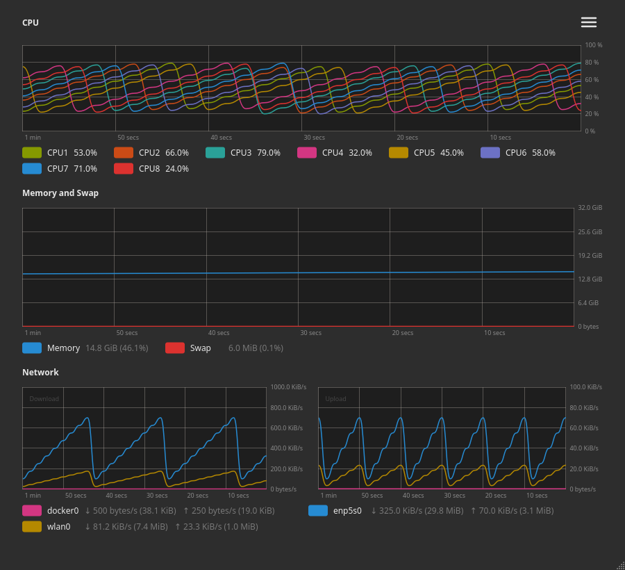

# Prism

Graphs of the use of the processors, memory and swap, and network adapters.
It is written in Go with Qt 6, through the
[miqt](https://github.com/mappu/miqt) bindings, and runs on Linux and macOS.



## What it shows

- **CPU**: how busy each logical processor is, a line for each, or one line
  for all of them together (Settings > General > Display).
- **Memory and Swap**: how much of each is in use, on a scale from nothing to
  how much memory is installed, and in the legend how much that is with its
  percentage of the whole. Memory in use is what is not available to
  programs, which leaves out caches that can be dropped.
- **Network**: how fast each network adapter downloads (left) and uploads
  (right), a line for each, virtual ones included, each graph to the scale of
  its fastest. The legend says, beside each adapter's name, how fast it is
  downloading (↓) and uploading (↑), with how much it has in all in brackets.
  Adapters can be hidden in the settings.

A status bar along the bottom of the window has a handle in its corner to
drag the window bigger or smaller by.

Click a swatch in a legend to choose the colour of its line; it is saved at
once, as if chosen in the settings.

What each legend says of a line is written beside its name: the use of each
processor plainly, and that of memory, swap and the network adapters at 40%
opacity, so that the names stand out. The labels of the
graphs' scales and times are written small, at 50% opacity. The network graphs
have "Download" and "Upload" written faintly in their top left corners.

A graph spans a minute, or two update intervals where they are longer than
half a minute, so that it always has a line. Each statistic is read at an
interval of its own. Every graph is drawn across its whole width from the first
reading: the processors and adapters at 0 until their use is known, and memory
at what it first is.

### Where the statistics come from

- **Linux**: `/proc/stat`, `/proc/meminfo`, and
  `/sys/class/net/*/statistics/{rx,tx}_bytes`, and nothing else.
- **macOS**: the Mach kernel's processor and memory statistics
  (`host_processor_info`, `host_statistics64`), `sysctl` for the size of
  memory and the use of swap, and the 64 bit counters of the network
  adapters (`NET_RT_IFLIST2`). Memory in use is counted as Activity Monitor
  counts it: memory of programs, wired, and compressed.

## Settings

The menu bar has **File** (Settings, Quit with Ctrl+Q) and **Help** (About
Prism with Ctrl+I: the version of Qt and the licences of what Prism is
built with). On macOS these are in the application's menu.

**File > Settings** (Ctrl+, or ⌘, on macOS) has:

- **General**: the update interval of each statistic, in seconds to a tenth
  of a second, from 0.1 to 3600 (2 by default); whether the processors have a line each or one for
  all; and the units: sizes in binary (KiB, MiB) or decimal (kB, MB) units,
  and network speeds in bytes (MiB/s) or bits (Mib/s) a second.
- **Network**: every network adapter that has been seen, ticked if it is
  shown in the network graphs and legend. An adapter that is not ticked is
  still read, so its lines are whole when it is shown again, and it keeps its
  choice when it goes away, for when it comes back. Each can be given an
  alias, which the legend shows in place of its name.
- **User interface**: the theme, light, dark, or following the system; and a
  table, as TriggerAPI has, of the colours of the grid, memory,
  swap, all processors together, each processor, and each network adapter
  that has been seen, under a heading for each. Click a swatch to choose
  another colour; colours can be translucent. An adapter is given a colour
  when it is first seen, and keeps it when it goes away. **Use Default
  Colours** puts back the colours alone. The default colours are the eight
  accents of Solarized, which read well on light and dark alike, on a grid of
  the warm grey of Ubuntu's Ambiance. Each processor's colour is across the
  colour wheel from the one before; beyond eight, they are variants of the
  same accents.

**Restore Defaults** puts every setting back as it was at first, showing every
adapter and giving them their colours afresh.

The settings, and the size of the window, are kept in
`prism/settings.json` where the system keeps the configuration of
programs, as ApeMail's are: `~/.config` on Linux (or `$XDG_CONFIG_HOME`), and
`~/Library/Application Support` on macOS.

## One copy at a time

Only one copy of Prism runs for each user. Starting it again, as from the
desktop's menu, brings the window of the copy that runs to the front, raised
and focused (under Wayland too, through the desktop's activation token), and
the new copy leaves. The copy that runs holds a lock on `prism.lock`, which
the system lets go of if it dies, and listens on `prism.sock` beside it, in
`$XDG_RUNTIME_DIR`, or else in a folder of the user's own in the temporary
folder.

## Desktop entry

On Linux, every time it starts, Prism adds itself to the desktop's
applications, so that it can be started from the menu and kept in a dock or
sidebar: it writes `~/.local/share/applications/prism.desktop` and its icon
to `~/.local/share/icons/hicolor/256x256/apps/prism.png` (or under
`$XDG_DATA_HOME`). The entry starts the copy that ran last, wherever it is,
the AppImage if it was run from one. If the desktop keeps showing an older
icon after an update, it has the old one cached: logging out and in again
clears it (on KDE, so does deleting `~/.cache/icon-cache.kcache`).

## Building

It needs Go, a C++ compiler, pkg-config and the Qt 6 development files (on
Debian and Ubuntu, `qt6-base-dev`; on Arch, `qt6-base`; on macOS, Homebrew's
`qtbase`). The bindings take some minutes to compile the first time.

```sh
make build      # builds ./prism
make run        # builds and runs it
make test       # runs the tests
make vet
make screenshot # draws docs/screenshot.png
make icons      # draws the icons, after their drawing changes
```

Build after every change, and lint with `staticcheck ./...` and
`deadcode -test ./...`, which must both be clean. A GitHub workflow
(`.github/workflows/build.yml`) also builds the program, vets it, runs the
tests and lints it on every push and pull request.

Dependencies come from their upstream repositories only: the Qt bindings are
`github.com/mappu/miqt`, and `go.mod` has no `replace` directives or local
paths.

## AppImage

Releases for Linux are an AppImage, `Prism-*-x86_64.AppImage`: one
file with Qt inside it, which runs without installing anything. Make it
executable and run it.

It is built by a GitHub workflow (`.github/workflows/appimage.yml`), which
runs the tests and `packaging/appimage.sh` on Ubuntu 24.04:

- Pushing a tag starting with `v` builds it and attaches it to a release of
  that name: `git tag v1.0.0 && git push origin v1.0.0`.
- It can also be run by hand from the Actions tab of the repository
  (AppImage > Run workflow), which leaves the AppImage as an artifact of the
  run to download.

It runs under both X11 and Wayland, and on GTK desktops takes its colours, light or
dark, from the desktop through Qt's GTK theme plugin. It runs on any system
with glibc 2.39 or later: rolling distributions such as CachyOS and Arch,
Ubuntu 24.04, Debian 13, Fedora 40 and anything newer.

`make appimage` runs the same script locally, but an AppImage built on a newer
system only runs on systems at least as new.

## macOS app

Releases for macOS are a disk image, `Prism-*-arm64.dmg`, for Macs
with Apple Silicon. Open it and drag Prism into Applications.

The app is not signed with an Apple Developer ID or notarised by Apple, so
the first time it is opened macOS says that it cannot check it for malicious
software and will not open it. Either:

- Open System Settings > Privacy & Security, where Prism is named
  beneath Security, and choose Open Anyway, or
- take away the mark macOS gives what is downloaded, in Terminal:

  ```sh
  xattr -dr com.apple.quarantine "/Applications/Prism.app"
  ```

Either is only needed once.

It is built by a GitHub workflow (`.github/workflows/macos.yml`), which runs
the tests and `packaging/macos.sh` on a Mac with Apple Silicon and Homebrew's
Qt, when a `v` tag is pushed, as the AppImage is, or by hand from the Actions
tab (macOS > Run workflow). `make macos` runs the same script on a Mac.

## Layout

- `internal/stats` reads the counters of the system: `/proc` and `/sys` on
  Linux, Mach and `sysctl` on macOS.
- `internal/usage` works out from one reading to the next how busy the
  processors were and how fast the adapters received and sent.
- `internal/history` keeps the values of each line of a graph.
- `internal/chart` does the arithmetic of the graphs: scales, labels, where
  each point goes, and how a legend is laid out.
- `internal/settings` loads and saves the settings, and gives colours.
- `internal/instance` keeps to one copy running, and hands over to it.
- `internal/desktop` writes the Linux desktop entry and its icon.
- `internal/appicon` draws the icon, a prism: a triangle divided into Solarized red, blue and green thirds.
- `internal/ui` is the window, the graphs and legends it paints, the
  settings dialog and the about box.
- `.github/workflows` has `build.yml` (every push and pull request),
  `appimage.yml` and `macos.yml` (`v` tags, or by hand).
