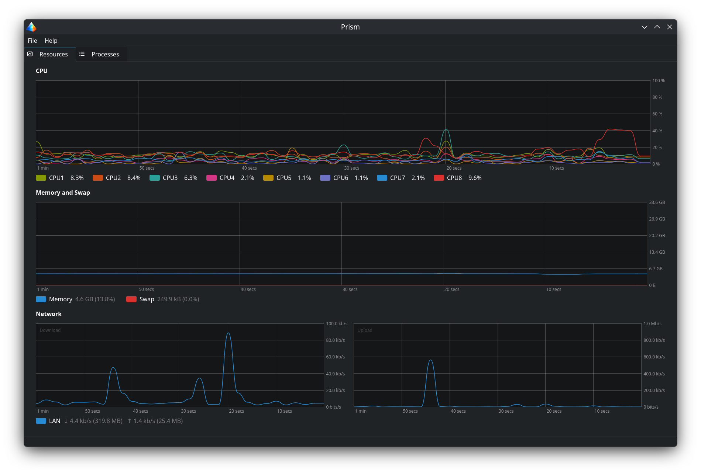

#  Prism

Graphs of the use of the processors, memory and swap, and network adapters,
and a tree of the processes that are running.
It is written in Go with Qt 6, through the
[qute](https://github.com/nomad-software/qute) bindings, and runs on Linux.



## Why use it

- **Everything at a glance, in one small window.** Every processor, memory
  and swap, and every network adapter, each drawn as a line over the last
  minute, with the numbers beside them; and a tab of the processes, a
  shortcut away (Ctrl+2), to find what is busy and stop it.
- **It answers "what is using my machine?"** Sort the processes by how busy
  they are or how much memory they have, search for them by name or PID,
  see them as a tree to find what started what, fold away what does not
  matter, and send the one at fault a signal: SIGKILL, SIGTERM, or another,
  to end it, stop it or go on.
- **It asks for nothing.** No root, no daemon, no service, no account and
  nothing sent anywhere: it only reads what the kernel already says, in
  `/proc` and `/sys`.
- **It is light.** One program, one window, and one copy running at a time;
  each statistic is read at an interval of its own, from a tenth of a second
  to an hour, so it costs as little as wanted; and the graphs are drawn only
  as often as their lines move by a pixel, and not at all while they are
  out of sight.
- **It looks right on the desktop.** A native Qt program that follows the
  desktop's light or dark theme, or one of its own, with colours that read
  well on either, every one of which can be chosen. It remembers its size,
  its settings and how the processes were last shown.
- **It is easy to have.** One AppImage file that runs on most Linux
  systems without installing anything; free software, under the GPLv3.

## What it shows

The window has two tabs: **Resources**, with the graphs, and **Processes**;
Ctrl+1 and Ctrl+2 switch between them.

- **CPU**: how busy each logical processor is, a line for each, or one line
  for all of them together (Settings > General > Display).
- **Memory and Swap**: how much of each is in use, on a scale from nothing to
  the power of 2 the memory comes to (32 GB for what is sold as 32 GB, in the
  units chosen), or to the maximum chosen in Settings > General > Display, and
  higher only if more is in use; and in the legend how much that is with its
  percentage of the whole. Memory in use is what is not available to
  programs, which leaves out caches that can be dropped.
- **Network**: how fast each network adapter downloads (left) and uploads
  (right), a line for each, virtual ones included, each graph to the scale of
  its fastest. The legend says, beside each adapter's name, how fast it is
  downloading (↓) and uploading (↑), with how much it has in all in brackets.
  Adapters can be hidden in the settings.
- **Processes**: every process, and a way to send the one chosen a signal;
  see [The Processes tab](#the-processes-tab).

A status bar along the bottom of the window has a handle in its corner to
drag the window bigger or smaller by.

Click a swatch in a legend to choose the colour of its line; it is saved at
once, as if chosen in the settings.

What each legend says of a line is written beside its name: the use of each
processor plainly, and that of memory, swap and the network adapters at 40%
opacity, so that the names stand out. The labels of the graphs' scales and
times are written small, at 50% opacity. The network graphs have "Download"
and "Upload" written faintly in their top left corners.

A graph spans a minute, or two update intervals where they are longer than
half a minute, so that it always has a line. Each statistic is read at an
interval of its own. Every graph is drawn across its whole width from the
first reading: the processors and adapters at 0 until their use is known, and
memory at what it first is. Between readings the graphs move along smoothly,
each line held at its last value out to the right edge until the next
reading puts it right. They are drawn again only as often as their lines
move by a pixel (at most 60 times a second), so a narrow window or a long
interval draws them less often, and not at all while they are not shown:
on the Processes tab or with the window minimized. The grid and its labels
are drawn once, and again only when the size, scale, theme or colours
change. The lines are slid along between readings, and each reading draws
only what is new of them, unless the scale, size or colours change.

### The Processes tab

- **Columns**: the PID; the name, in full, though Linux keeps only the first
  15 characters of it with the process's statistics; CPU, how busy it is as
  top counts it, a percentage of one processor, so more than 100% for one
  running on several, with a heading that says how many there are, as
  "CPU (8 cores)"; Cores Used, how many processors' worth of time that is,
  2.5 for 250%; and Memory, what is resident, "—" for the kernel's own
  threads, which have none of their own to count. The PID column is as wide as the
  largest PID, and the others share the rest of the width, the name two fifths of it.
- **Sorting**: click a heading to sort by it, and again to reverse it. It
  starts with the busiest first, and keeps the order chosen for next time.
- **Searching**: type in the box above the table to narrow it, as you type,
  to the processes whose names (in any case) or PIDs hold what is typed. The
  box has the cursor whenever the tab is shown, so you can start typing at
  once, and the search is not kept for next time.
- **Which, and how**: below the table, at the left, choose to see the
  processes of people (User, the default), the system's (System: those of
  root, of services and of the kernel) or All of them, and, with the two
  buttons beside "Show as", to see them as a List or as a Tree, each
  process under the one that started it. Branches
  fold and open with the arrows beside the names, and stay as they are left;
  a process found by a search whose parent is not found is at the top. These
  choices are kept for next time too.
- **Signals**: choose a process, then a signal (SIGKILL unless another is
  chosen), and **Send Signal** sends it; the status bar says whether it was
  sent. A process that has ended in the meantime is not sent it, even if its
  PID has been given to another.

### Where the statistics come from

`/proc/stat`, `/proc/meminfo`, `/sys/class/net/*/statistics/{rx,tx}_bytes`,
and for each process `/proc/<pid>/stat`, `/proc/<pid>/statm` and
`/proc/<pid>/status`, with `/proc/<pid>/cmdline` for the full name of one
whose name the kernel cuts short at 15 characters, and nothing else.

## Settings

The menu bar has **File** (Settings, Quit with Ctrl+Q) and **Help** (About with
Ctrl+I: the version of Prism, the version of Qt and the licences of what Prism
is built with).

**File > Settings** (Ctrl+,) has:

- **General**: the update interval of each statistic and of the processes,
  in seconds to a tenth of a second, from 0.1 to 3600 (by default 1 for the
  processors and memory, and 2 for the network and processes);
  whether the processors have a line each or one for all; the maximum memory
  the memory graph's scale goes to (by default the power of 2 the memory comes
  to); and the units:
  sizes in binary (KiB, MiB) or decimal (kB, MB, the default) units, and
  network speeds in bytes (MB/s) or bits (Mb/s, the default) a second.
- **Network**: every network adapter that has been seen, ticked if it is
  shown in the network graphs and legend. An adapter that is not ticked is
  still read, so its lines are whole when it is shown again, and it keeps its
  choice when it goes away, for when it comes back. Each can be given an
  alias, which the legend shows in place of its name.
- **User interface**: the theme, light, dark, or following the system; and a
  table of the colours of the grid, memory, swap, all processors together,
  each processor, and each network adapter that has been seen, under a
  heading for each. Click a swatch to choose
  another colour; colours can be translucent. An adapter is given a colour
  when it is first seen, and keeps it when it goes away. **Use Default
  Colours** puts back the colours alone. The default colours are the eight
  accents of Solarized, which read well on light and dark alike, on a grid of
  the warm grey of Ubuntu's Ambiance. Each processor's colour is across the
  colour wheel from the one before; beyond eight, they are variants of the
  same accents.

**Restore Defaults** puts every setting back as it was at first, showing every
adapter and giving them their colours afresh.

The settings, and the size of the window, are kept in
`prism/settings.json` where the system keeps the configuration of programs:
`~/.config` (or `$XDG_CONFIG_HOME`).

## One copy at a time

Only one copy of Prism runs for each user. Starting it again, as from the
desktop's menu, brings the window of the copy that runs to the front, raised
and focused (under Wayland too, through the desktop's activation token), and
the new copy leaves. The copy that runs holds a lock on `prism.lock`, which
the system lets go of if it dies, and listens on `prism.sock` beside it, in
`$XDG_RUNTIME_DIR`, or else in a folder of the user's own in the temporary
folder.

## Desktop entry

Every time it starts, Prism adds itself to the desktop's
applications, so that it can be started from the menu and kept in a dock or
sidebar: it writes `~/.local/share/applications/prism.desktop` and its icon
to `~/.local/share/icons/hicolor/128x128/apps/prism.png` (or under
`$XDG_DATA_HOME`). The entry starts the copy that ran last, wherever it is,
the AppImage if it was run from one. If the desktop keeps showing an older
icon after an update, it has the old one cached: logging out and in again
clears it (on KDE, so does deleting `~/.cache/icon-cache.kcache`).

## Requirements

Prism runs on Linux, and on no other system.

Building needs:

- Go 1.27.1 or later
- A C++ compiler (GCC or Clang) with C++17
- `pkg-config`
- The development files of Qt Widgets, Qt 6.12 or newer: the bindings,
  qute, are made from Qt 6.12 and use its API, so an older Qt does not
  compile them. The tests also use Qt Test, which comes with it.

Install them with your distribution's package manager:

```sh
# Arch, CachyOS, Manjaro
sudo pacman -S go gcc pkgconf qt6-base

# Debian, Ubuntu
sudo apt install golang-go build-essential pkg-config qt6-base-dev

# Fedora
sudo dnf install golang gcc-c++ pkgconf-pkg-config qt6-qtbase-devel

# openSUSE
sudo zypper install go gcc-c++ pkgconf-pkg-config qt6-base-devel
```

If your distribution's Go is older than 1.27.1, install Go from
[go.dev/dl](https://go.dev/dl/) instead. If its Qt is older than 6.12,
install Qt's own build of Qt 6.12 or newer (with the Qt online installer, or
`aqtinstall` as the AppImage workflow does), and point `pkg-config` at it:
`export PKG_CONFIG_PATH=<qt>/gcc_64/lib/pkgconfig`.

Check that Qt can be found with:

```sh
pkg-config --modversion Qt6Widgets
```

This should print 6.12 or later.

Running a built binary on another machine only needs the Qt 6.12 (or newer)
runtime libraries (`qt6-base` on Arch, `libqt6widgets6` on Debian and Ubuntu,
`qt6-qtbase` on Fedora, `libQt6Widgets6` on openSUSE). The icons are
Prism's own, built in, so no icon theme is needed.

## Building

The first build compiles the C++ side of the Qt bindings and takes a few
minutes. Later builds use the Go build cache and take a few seconds.

```sh
make build      # builds ./prism
make run        # builds and runs it
make test       # runs the tests
make bench      # times drawing the graphs and refreshing the processes
make vet        # runs go vet
make screenshot # draws docs/screenshot.png
make appimage   # builds ./Prism-<version>-x86_64.AppImage (see below)
make clean      # removes them, and the AppImage's build folder
```

Only what is made is put in the project: `./prism`, and the AppImage. Go
compiles in a folder of its own in the temporary folder, and the AppImage is
put together in `$TMPDIR/prism-build` (or `/tmp/prism-build`). Both results
are ignored by git.

`make bench` runs the benchmarks in `internal/ui/bench_test.go`: a frame of
the graphs between readings, a reading of every statistic with the graphs
and legends drawn, a refresh of 600 processes as a list and as a tree, and the
whole window drawn, each with a window of 16 processors and 4 adapters.

The about box shows the version Go records from git when it builds: the tag,
or the last tag for a build after it. A build Go records no version for, as
one made outside a git checkout, shows "dev".

Build after every change, and lint with `staticcheck ./...`,
`deadcode -test ./...` and qute's own `qute vet ./...` (ownership and
threading mistakes; `go install github.com/nomad-software/qute/cmd/qute@latest`),
which must all be clean.

Dependencies come from their upstream repositories only: the Qt bindings are
`github.com/nomad-software/qute`, and `go.mod` has no `replace` directives or
local paths.

## AppImage

Releases for Linux are an AppImage, `Prism-*-x86_64.AppImage`: one
file with Qt inside it, which runs without installing anything. Make it
executable and run it.

It is built by a GitHub workflow (`.github/workflows/appimage.yml`), which
runs `packaging/appimage.sh` on Ubuntu 22.04 with Qt's own build of Qt 6.12:

- Pushing a tag starting with `v` builds it and attaches it to a release of
  that name: `git tag v1.0.0 && git push origin v1.0.0`.
- It can also be run by hand from the Actions tab of the repository
  (AppImage > Run workflow), which leaves the AppImage as an artifact of the
  run to download.

It runs under both X11 and Wayland, and on GTK desktops takes its colours,
light or dark, from the desktop through Qt's GTK theme plugin. The C library
of the system (glibc) is not put in the AppImage, as it cannot be reliably:
it has to match the system's graphics drivers. It is built on an old
distribution instead, and runs on any with glibc 2.35 or later: Ubuntu 22.04,
Debian 12, Fedora 36 and anything newer, or rolling distributions such as
CachyOS and Arch.

`make appimage` runs the same script locally, but an AppImage built on a newer
system only runs on systems at least as new. It builds in `/tmp/prism-build`
(`BUILD_DIR` to choose another), keeping the tools it downloads there for the
next time, and puts only the AppImage in the root of the project.

## Layout

- `internal/stats` reads the counters of the system and its processes, from
  `/proc` and `/sys`, and sends processes signals.
- `internal/usage` works out from one reading to the next how busy the
  processors and processes were and how fast the adapters received and sent.
- `internal/history` keeps the values of each line of a graph.
- `internal/chart` does the arithmetic of the graphs: scales, labels, where
  each point goes, and how a legend is laid out.
- `internal/settings` loads and saves the settings, and gives colours.
- `internal/instance` keeps to one copy running, and hands over to it.
- `internal/desktop` writes the Linux desktop entry and its icon.
- `internal/appicon` holds the icon, a glass prism, built into the program.
- `internal/ui` is the window and its tabs, the graphs and legends it paints,
  the table of processes, the settings dialog, the about box and the themes.
- `packaging` has the script and files that make the AppImage.
- `.github/workflows` has `appimage.yml` (`v` tags, or by hand).
